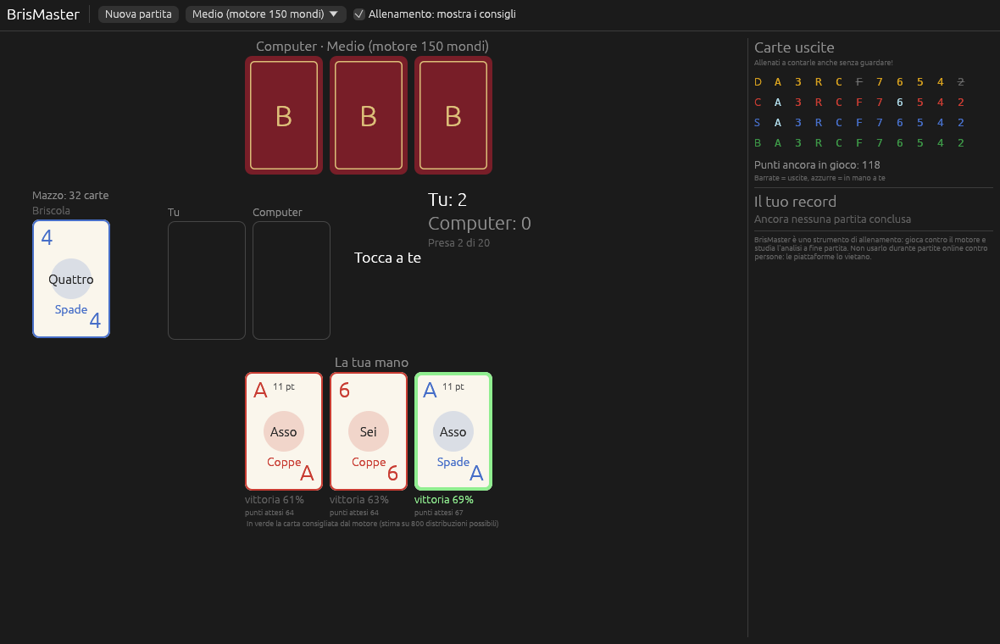

# BrisMaster

Allenatore di briscola per Windows. Giochi contro un motore forte, in modalità allenamento ti mostra la mossa migliore con la probabilità di vittoria di ogni carta, e a fine partita analizza tutte le tue scelte.



> BrisMaster è uno strumento di allenamento. Non è pensato per essere usato durante partite online contro altre persone: le piattaforme di gioco lo vietano nei loro regolamenti sul fair play.

## Installazione

1. Scarica `BrisMaster.exe` dall'[ultima release](https://github.com/motthz/BrisMaster/releases/latest).
2. Mettilo in una cartella tua (per esempio `Documenti\BrisMaster`) e avvialo.
3. Al primo avvio Windows SmartScreen può avvisare che l'app non è firmata: *Ulteriori informazioni → Esegui comunque*.

Gli aggiornamenti sono automatici: all'avvio l'app controlla le release di questo repository e, se ce n'è una più recente, mostra il pulsante **Installa**. L'app scarica la nuova versione, sostituisce l'eseguibile e si riavvia.

## Cosa fa

- **Partita contro il computer** a tre livelli: Facile (regole pratiche), Medio (motore con 150 simulazioni per mossa), Difficile (motore con 1000 simulazioni per mossa).
- **Allenamento**: sotto ogni carta della tua mano compaiono la probabilità di vincere la partita e i punti attesi giocandola; la carta consigliata è bordata di verde.
- **Analisi a fine partita**: ogni tua scelta viene rivalutata con 2000 simulazioni e classificata come ottima, imprecisione o errore, con la mossa migliore indicata.
- **Carte uscite**: tabella delle carte già giocate e dei punti ancora in gioco, per allenarti a contare.

## Come ragiona il motore

Il motore usa il **Monte Carlo determinizzato** (PIMC):

1. Dalle carte che conosce (la propria mano, la briscola, le carte uscite) genera centinaia di distribuzioni possibili delle carte coperte.
2. In ogni distribuzione prova ciascuna carta della mano e simula il resto della partita.
3. Quando nel mazzo restano quattro carte o meno risolve la partita in modo esatto con alfa-beta.
4. Gioca la carta con la probabilità di vittoria più alta (a parità, quella con più punti attesi).

Il motore vede solo quello che vedrebbe un giocatore: le simulazioni non sbirciano mai la mano avversaria.

## Test massivi

Il programma `briscola-sim` gioca migliaia di partite tra il motore e avversari di riferimento. Ogni mazzo si gioca due volte a posti invertiti, così la fortuna delle carte si compensa. Le percentuali sono accompagnate dall'intervallo di confidenza al 95% (Wilson).

```
cargo run --release -p briscola-sim -- --panel --deals 10000 --out bench/RISULTATI.md
cargo run --release -p briscola-sim -- --player engine:1000 --opponent ismcts:2000 --deals 5000
```

I risultati più recenti sono in [bench/RISULTATI.md](bench/RISULTATI.md).

Un limite importante: la briscola dipende molto dalle carte che arrivano. Contro avversari deboli o medi il motore vince nettamente più della metà delle partite, ma contro un giocatore forte quanto lui nessun algoritmo può garantire più del 50%: due copie dello stesso motore vincono per forza il 50% a testa.

## Struttura

| Cartella | Contenuto |
|---|---|
| `crates/core` | Regole, motore, avversari di riferimento, statistiche |
| `crates/sim` | Banco di prova per le simulazioni massive |
| `crates/app` | App Windows (egui) e aggiornamento automatico |

## Pubblicare una nuova versione

1. Aggiorna `version` in `Cargo.toml` (per esempio `0.2.0`).
2. Fai push su `main`.

GitHub Actions compila `BrisMaster.exe` su Windows, crea il tag `v0.2.0` e pubblica la release; le app già installate si aggiornano da sole. Il workflow si può anche lanciare a mano da *Actions → Release → Run workflow*.
