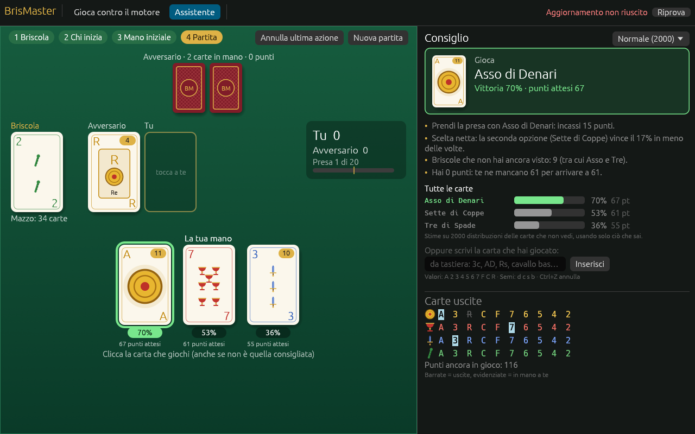
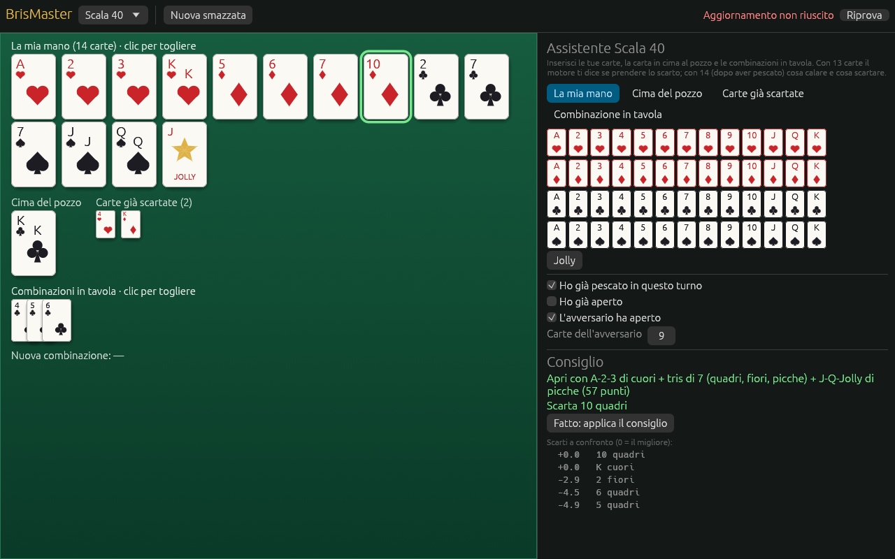
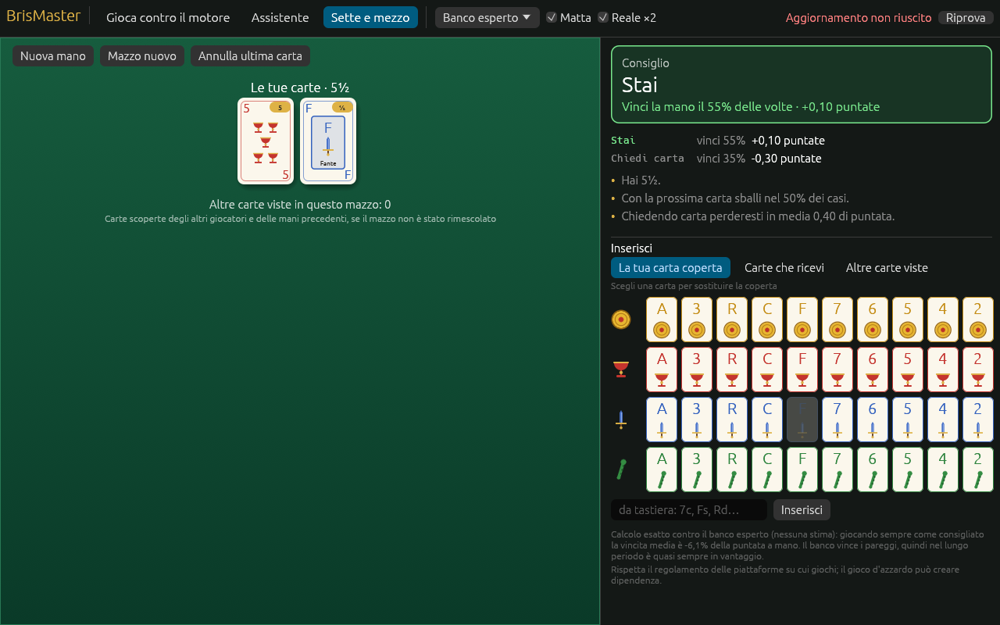
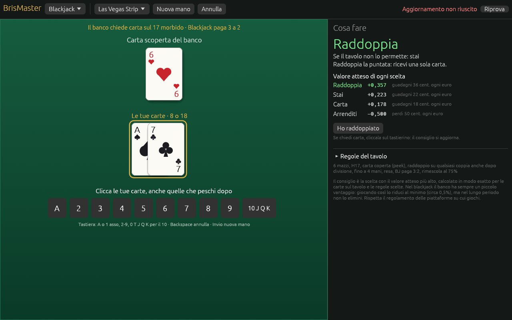
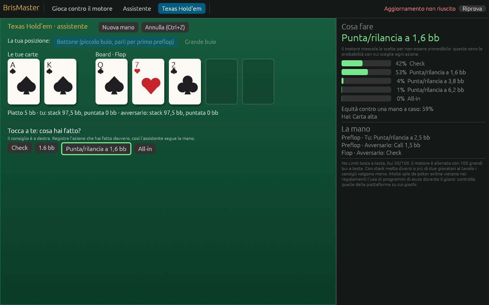

# BrisMaster

Assistente per i giochi di carte, per Windows. Scegli il gioco dal menu in alto a sinistra, inserisci tu come sta andando la partita (le tue carte, quelle che peschi, quelle giocate dagli avversari) e il motore ti dice cosa fare, con la probabilità di vittoria o il valore atteso di ogni alternativa.

Giochi: **briscola**, **scopa**, **scala 40**, **burraco**, **sette e mezzo**, **blackjack**, **poker all'italiana** e **Texas Hold'em**.



> Molte piattaforme di gioco online vietano nei loro regolamenti l'uso di programmi di aiuto durante le partite contro altre persone: controlla quelle della piattaforma su cui giochi.

## Installazione

1. Scarica `BrisMaster-Setup.exe` dall'[ultima release](https://github.com/motthz/BrisMaster/releases/latest) e aprilo.
2. L'installazione è per il tuo utente, senza permessi di amministratore: mette BrisMaster in `%LOCALAPPDATA%\Programs\BrisMaster`, crea il collegamento sul desktop e nel menu Start, e si disinstalla da *Impostazioni → App*. Partite salvate e memoria delle carte (in `Documenti\BrisMaster`) restano anche disinstallando.
3. Windows SmartScreen può avvisare che il programma non è firmato: *Ulteriori informazioni → Esegui comunque*. Se l'antivirus lo blocca, vedi [docs/ANTIVIRUS.md](docs/ANTIVIRUS.md).

Chi preferisce può scaricare solo `BrisMaster.exe` e avviarlo da una cartella sua, senza installazione. Se prima usavi l'exe così e passi all'installatore, cancella pure il vecchio exe: i dati sono in `Documenti\BrisMaster` e restano.

Gli aggiornamenti sono automatici: all'avvio l'app controlla le release di questo repository e, se ce n'è una più recente, mostra il pulsante **Installa**. L'app scarica la nuova versione, sostituisce l'eseguibile e si riavvia.

## Briscola

- **Assistente**: inserisci a mano la briscola, chi comincia, le tue carte, le carte che peschi e quelle giocate dall'avversario. Per ogni tua mossa il motore indica la carta da giocare, la probabilità di vittoria di ogni alternativa e una spiegazione a parole (prendere o lasciare, tagliare, quante briscole e carichi sono ancora fuori, quanti punti ti mancano). Le carte si inseriscono con un clic sulla griglia o da tastiera, senza cliccare da nessuna parte né premere Invio: scrivi valore e seme (`3c`, `AD`, `Rs`) e la carta entra appena digiti il seme. Per chi comincia premi 1 (tu) o 2 (l'avversario); al tuo turno **Spazio** inserisce la carta consigliata e 1, 2, 3 la carta in quella posizione della mano. Ogni passo si annulla con Ctrl+Z. L'app tiene il conto delle carte uscite, dei punti e del mazzo, sa da sola a chi va la briscola scoperta all'ultima pescata e inserisce da sola le carte obbligate (l'ultima presa). Con **Finestra compatta** l'app diventa una finestra stretta con solo la tua mano, il consiglio e l'inserimento, da tenere accanto al browser (volendo sempre in primo piano).

Con **Leggi la partita dallo schermo** (su Windows) BrisMaster guarda il tavolo del sito nel browser e inserisce da solo briscola, carte pescate e carte giocate: riconosce le carte confrontandole con le 40 napoletane di riferimento (`crates/app/assets/carte_napoletane.png`), e chi comincia dalla prima carta giocata. Funziona su qualunque tavolo (panno verde, blu, legno...), con lo schermo scurito o la luce notturna, con le carte dell'avversario girate e con le carte viste solo in parte: la briscola sotto il mazzo, una carta tagliata dal bordo o coperta da una scritta. Come carte conta solo quello che somiglia a una delle 40: dorsi, riquadri, scritte e pannelli del sito vengono ignorati, e anche le carte disegnate fuori dal tavolo. Una partita dopo l'altra riparte da sola: quando il sito distribuisce di nuovo (nuova briscola, tre carte in mano, tavolo vuoto) azzera anche se la partita prima si era interrotta a metà. Quando non è sicuro (per esempio la briscola vista a metà) ti mostra la carta che crede: Spazio conferma, oppure scrivi quella giusta. Ogni carta riconosciuta o confermata viene ricordata con la grafica del tuo sito (in `Documenti\BrisMaster\carte_viste.json`), anche la briscola vista a metà: dopo qualche partita tutte le carte sono in memoria e si riconoscono subito, anche quando sotto il mazzo se ne vede solo un pezzo. Così le domande spariscono. Le carte rimaste disegnate in mano per errore dal sito vengono ignorate. L'app legge solo i pixel dello schermo: non tocca il sito e le carte le giochi sempre tu.

BrisMaster guarda tutto il monitor e tiene solo le carte appoggiate sul tavolo, ignorando il resto del desktop; con più monitor passa a quello dove ci sono le carte. Se sbaglia, **Scegli area** ti fa scegliere il monitor e trascinare un rettangolo attorno al tavolo (la scelta viene ricordata in `Documenti\BrisMaster\schermo.json`, **Automatica** la toglie). **Salva diagnosi** salva in `Documenti\BrisMaster\Diagnosi` quello che l'app vede (foto, riquadri delle carte trovate e cosa ha letto): sono i file da mandare se il riconoscimento non funziona.
- **Carte uscite**: tabella delle carte già giocate e dei punti ancora in gioco.

### Come ragiona il motore

Il motore usa il **Monte Carlo determinizzato** (PIMC):

1. Dalle carte che conosce (la propria mano, la briscola, le carte uscite) genera centinaia di distribuzioni possibili delle carte coperte.
2. In ogni distribuzione prova ciascuna carta della mano e simula il resto della partita. Nelle simulazioni entrambi i giocatori vedono le carte di quella distribuzione: chi apre prevede la risposta, chi risponde prende quando conviene e non spreca le briscole. Quando nel mazzo restano due carte la simulazione si ferma e il resto si risolve in modo esatto.
3. Quando nel mazzo restano otto carte o meno risolve ogni distribuzione in modo esatto con alfa-beta.
4. Gioca la carta con la probabilità di vittoria più alta (a parità, quella con più punti attesi).

Nell'Assistente la precisione di serie (Massima) usa invece l'**ISMCTS potenziato**: una ricerca ad albero sugli insiemi di informazione che, a ogni iterazione, sceglie una distribuzione delle carte coperte, scende nell'albero delle mosse già provate e finisce la partita con le stesse simulazioni del motore. Con 20.000 iterazioni (circa 40 ms a mossa) batte il motore a 3000 mondi nel 53% delle partite. Dalla v0.5.0 deduce anche le carte dell'avversario da come ha giocato: pesa le mani possibili con una piccola rete allenata su 60.000 partite tra motori, e così batte la Massima precedente nel 52,4% delle partite e il motore a 3000 mondi nel 54,5% (dettagli in `bench/RAPPORTO.md`). Le precisioni Veloce e Normale usano il motore a 1000 e 3000 mondi.

Il motore vede solo quello che vedrebbe un giocatore: le simulazioni non sbirciano mai la mano avversaria.

### Test massivi

Il programma `briscola-sim` gioca decine di migliaia di partite tra il motore e altri giocatori. Ogni mazzo si gioca due volte a posti invertiti, così la fortuna delle carte si compensa. Ogni risultato ha il suo intervallo di confidenza al 95%, calcolato sulle coppie di partite dello stesso mazzo.

```
# rapporto completo: 17 stili di avversario, contro se stesso, contro la versione precedente
cargo run --release -p briscola-sim -- report --deals 5000 --out bench/RAPPORTO.md
# un solo confronto, anche con una versione rilasciata
cargo run --release -p briscola-sim -- --player engine:1000 --opponent v0.1.1/engine:1000 --deals 5000
# pannello (aggiungi --extended per tutti gli stili)
cargo run --release -p briscola-sim -- --panel --deals 10000 --out tabella.md
```

L'ultimo rapporto completo è in [bench/RAPPORTO.md](bench/RAPPORTO.md).

**Quante partite servono.** `briscola-sim calibrate --deals 10000` fa giocare il motore contro se stesso: il risultato giusto è il 50%, e il numero di partite è sufficiente quando da lì in poi il punteggio resta entro un punto dal 50% e l'intervallo di confidenza è largo al più ±1 punto. Con meno partite anche due giocatori identici sembrano diversi.

**Controllo di regressione.** Su ogni pull request la CI gioca 10.000 partite tra il motore nuovo e quello dell'ultima release (job *regressione*) e fallisce se il nuovo è significativamente più debole. Dopo ogni release va aggiunta la nuova versione come riferimento: una riga in `crates/sim/Cargo.toml` e una voce in `crates/sim/src/agents.rs` (vedi il commento sulla macro `legacy!`).

Rapporto completo sulla v0.1.1 (livello Difficile), 10.000 partite per avversario, 260.000 in tutto. Punteggio: vittoria 1, pareggio ½; il 50% è la parità. Tabelle complete in [bench/RAPPORTO.md](bench/RAPPORTO.md).

| Avversari | Punteggio |
|---|---:|
| Stili umani (casuale, euristico, aggressivo, risparmiatore, briscolone, contacarte, principiante, rispondi di seme, butta-carichi, mai briscola) | 68% – 93% |
| Motore più debole e ISMCTS fino a 2000 iterazioni | 55% – 60% |
| ISMCTS 5000, 10.000 e 20.000 iterazioni | 54,4%, 53,3%, 51,5% |
| Varianti del motore stesso e versione precedente | 48% – 51% |

13 avversari su 24 sono sopra il 55% con certezza statistica.

Motore attuale, livello Difficile, 4.000 partite per avversario, tra parentesi la v0.1.1 (dettagli in [bench/RISULTATI.md](bench/RISULTATI.md)):

| Avversario | % vittorie | IC 95% |
|---|---:|---|
| Casuale | 94,4% (92,5) | 93,6 – 95,0 |
| Euristico | 70,2% (70,5) | 68,8 – 71,6 |
| Aggressivo | 80,7% (73,5) | 79,4 – 81,8 |
| Risparmiatore | 73,2% (72,5) | 71,8 – 74,5 |
| Briscolone | 75,3% (74,8) | 74,0 – 76,7 |
| Contacarte | 67,3% (67,3) | 65,8 – 68,7 |
| ISMCTS (2000 iterazioni) | 58,7% (54,1) | 57,2 – 60,2 |
| Motore livello Medio | 52,6% (53,8) | 51,0 – 54,1 |
| Motore della v0.1.1 (Difficile) | 52,6% su 20.000 partite | 51,9 – 53,3 |

Un limite importante: la briscola dipende molto dalle carte che arrivano. Contro avversari deboli o medi il motore vince nettamente più della metà delle partite, ma contro un giocatore forte quanto lui nessun algoritmo può garantire più del 50%: due copie dello stesso motore vincono per forza il 50% a testa.

## Scopa

Nell'app scegli **Scopa** dal menu in alto. C'è solo l'assistente: indichi chi gioca per primo (tasti 1 e 2)
e il punteggio della partita, le 4 carte in tavola, le carte che ricevi e ogni giocata dell'avversario (se
poteva prendere in più modi, scegli cosa ha preso). Il motore ti dice cosa giocare, con la probabilità di
vincere la partita e la differenza punti attesa nella smazzata, in pochi centesimi di secondo.

Per le partite a tempo funziona come la briscola: le carte si scrivono senza Invio (`3c`, `Rd`), al tuo turno
**Spazio** inserisce la mossa consigliata (carta e presa) e 1, 2, 3 la carta in quella posizione della mano;
quando una carta può prendere in più modi, 1, 2, 3... scelgono la presa (Spazio quella consigliata). Ctrl+Z
annulla, Invio passa alla smazzata dopo. Le giocate obbligate (la tua unica mossa, l'ultima carta
dell'avversario) entrano da sole. C'è la **Finestra compatta** (tavolo, mano numerata e consiglio).

Con **Leggi la partita dallo schermo** BrisMaster segue da solo la smazzata sul sito: le carte in tavola
(anche molte), quelle che ricevi, le carte giocate e le prese, che legge da quali carte spariscono dal
tavolo. Chi comincia lo capisce dalla prima giocata, e a fine smazzata riparte da solo con la distribuzione
successiva. Se una presa sparisce senza che si sia vista la carta che l'ha fatta e poteva farla più di
una carta, ti chiede quale (basta scriverla). Riconoscimento, conferme con Spazio e memoria delle carte
sono gli stessi della briscola (e la memoria è in comune).

Il motore campiona le possibili carte dell'avversario e del mazzo, gioca ogni mossa fino a fine smazzata
e calcola il finale esatto quando il mazzo è finito; ogni smazzata vale per la probabilità di vincere la
partita a 11 dato il punteggio. Dalla 0.5.0 deduce anche le carte che l'avversario ha in mano dalle
sue giocate nel giro (chi non fa una scopa possibile probabilmente non ha la carta per farla) e usa
1600 mondi: sopra il 60% contro tutti gli stili umani provati, migliore del motore precedente contro
tutti i 16 avversari. I test sono in [bench/SCOPA.md](bench/SCOPA.md):

```
cargo run --release -p scopa-sim -- report --player engine:400 --deals 4000 --self-deals 4000 --out bench/SCOPA.md
cargo run --release -p scopa-sim -- --player engine:1600:0:infer --opponent ismcts:20000 --deals 4000
```

## Scala 40

Scegli **Scala 40** dal menu in alto a sinistra. È solo un assistente: descrivi tu la smazzata e il motore ti dice cosa fare.



1. Inserisci le tue carte dalla griglia (scheda *La mia mano*), la carta in cima al pozzo e, se vuoi, le carte già scartate.
2. Metti in tavola le combinazioni già calate (scheda *Combinazione in tavola*, poi *Metti in tavola*) e indica chi ha già aperto e quante carte ha l'avversario.
3. Prima di pescare l'app ti dice se prendere lo scarto e cosa farci; dopo aver pescato (spunta *Ho già pescato*) ti dice cosa calare, cosa attaccare, quale jolly prendere e cosa scartare, con il confronto tra gli scarti.
4. *Fatto: applica il consiglio* aggiorna mano, tavolo e pozzo; al turno dell'avversario metti il suo scarto in cima al pozzo, poi aggiungi la carta che peschi.

Regole usate: due giocatori, 13 carte, apertura con almeno 40 punti, la carta presa dal pozzo va usata subito, un jolly per combinazione, il jolly in tavola si può sostituire dopo aver aperto. Chi chiude non paga; l'altro paga le carte in mano (jolly 25, asso 11, figure 10) o 100 se non ha aperto; a 101 si perde.

Il motore scompone la mano in combinazioni, coppie da completare e carte spaiate, conta quante carte ancora in gioco completano ogni coppia, pesa i punti che pagherebbe se l'avversario chiudesse e il rischio di scartare una carta che l'avversario può usare; per le scelte migliori guarda anche la media su tutte le pescate possibili del turno dopo. Su 8.000 partite complete per avversario (fino a 101 punti, in duplicato) supera il 55% contro 9 avversari su 10, contro se stesso fa il 49,4% (atteso 50%): tabelle in [bench/SCALA40.md](bench/SCALA40.md).

```
cargo run --release -p scala40-sim -- report --matches 4000 --out bench/SCALA40.md
cargo run --release -p scala40-sim -- --player engine --opponent defensive --matches 1000
```

## Burraco

Per il **burraco** (a due giocatori) c'è l'assistente: indichi le tue 11 carte e la carta scoperta, poi a ogni turno cosa peschi, cosa cala e scarta l'avversario e le carte del pozzetto quando lo prendi. Il motore ti dice se pescare dal tallone o raccogliere gli scarti, cosa calare e in che ordine, e cosa scartare, con la probabilità di vincere la smazzata per ogni alternativa. Le carte si inseriscono con un clic sulla griglia o da tastiera (`7c`, `Kq`, `10p`, `Af`, `jk` per il jolly); ogni passo si annulla con Ctrl+Z.

Il motore del burraco (`crates/burraco`) è un giocatore esperto tarato con decine di migliaia di smazzate, più simulazioni Monte Carlo sulle due scelte decisive del turno: pescare o raccogliere e quale carta scartare. Su 8.000 smazzate per avversario vince tra il 58% e l'87% contro 9 stili diversi, sempre sopra il 55% con certezza statistica, e il 50% contro se stesso (come deve essere): dettagli in [bench/BURRACO.md](bench/BURRACO.md).

## Sette e mezzo

Nella scheda **Sette e mezzo** inserisci la tua carta coperta e le carte che ricevi (con un clic sulla griglia o da tastiera, `7c`, `Fs`, `Rd`) e l'app ti dice se **chiedere carta o stare**, con la probabilità di vincere la mano e la vincita media di ciascuna scelta. Se il mazzo non viene rimescolato a ogni mano puoi aggiungere le *altre carte viste* (degli altri giocatori o delle mani precedenti): il consiglio ne tiene conto.



- **Regole**: matta (Re di Denari, vale ½ oppure da 1 a 7) e sette e mezzo reale pagato doppio, entrambi disattivabili. Il pareggio va al banco.
- **Come gioca il banco**: *a soglia 5, 5½ o 6* (si ferma appena ci arriva, senza guardare le tue carte) oppure *esperto* (guarda le tue carte scoperte e decide per vincere il più possibile). Se non sai come gioca il tuo banco scegli *esperto*: è la scelta più prudente.
- **Calcolo esatto**: il consiglio non è una stima. Il programma enumera tutte le carte che possono uscire a te e al banco e sceglie la mossa con la vincita media più alta.

Il banco resta in vantaggio anche giocando in modo perfetto (vince i pareggi e chi sballa perde subito): la strategia ottimale perde il meno possibile. Rendimento per mano, giocando sempre come consigliato, rispetto alla migliore regola fissa ("chiedo finché ho meno di…"):

| Banco | Strategia di BrisMaster | Migliore regola fissa |
|---|---:|---:|
| A soglia 5 | −11,5% | −13,1% |
| A soglia 5½ | −7,2% | −10,3% |
| A soglia 6 | −2,4% | −8,3% |
| Esperto | −6,1% | −7,3% |

Valori esatti, verificati con 1.000.000 di mani simulate per ogni strategia e ogni banco. Rapporto completo, con criteri e intervalli di confidenza, in [bench/SETTEMEZZO.md](bench/SETTEMEZZO.md):

```
cargo run --release -p settemezzo -- --hands 1000000 --out bench/SETTEMEZZO.md
```

## Blackjack

Scegli **Blackjack** nella tendina in alto a sinistra. Inserisci la carta scoperta del banco e le tue carte (clic sul tastierino o da tastiera: `A` o `1` per l'asso, `2`-`9`, `0` `T` `J` `Q` `K` per il 10) e l'app ti dice cosa fare: carta, stai, raddoppia, dividi o arrenditi, con il valore atteso di ogni scelta. Le carte che peschi si aggiungono allo stesso modo e il consiglio si aggiorna; dopo una divisione l'app segue le due mani una alla volta. Backspace annulla, Invio inizia una nuova mano.



Il consiglio dipende dalle regole del tavolo: scegli quelle giuste nella tendina (Europeo, Atlantic City, Las Vegas) o personalizzale in *Regole del tavolo*. Per ogni decisione l'app calcola in modo esatto il valore atteso di ogni azione, togliendo dal sabot le carte sul tavolo.

Il blackjack si gioca contro il banco, che ha sempre un piccolo vantaggio: giocando come dice l'app con le regole online tipiche si perde in media lo 0,65% di quanto si punta, contro il 5-6% di chi gioca "a sensazione". Nel lungo periodo non si vince; nelle sessioni brevi circa 47 sessioni da 100 mani su 100 si chiudono in attivo. Il rapporto completo, con 100 milioni di mani per strategia, è in [bench/BLACKJACK.md](bench/BLACKJACK.md):

```
cargo run --release -p blackjack-core --bin blackjack-sim -- report --hands 100000000 --out bench/BLACKJACK.md
cargo run --release -p blackjack-core --bin blackjack-sim -- chart --rules 0   # tabella della strategia di base
```

## Poker all'italiana

Scegli **Poker all'italiana** dal menu: è il poker a 5 carte con il cambio, testa a testa, con il mazzo da 32 carte (dal 7 all'asso). Inserisci le tue carte, le azioni dell'avversario e quante carte cambia; l'app ti dice se passare, vedere, puntare o rilanciare, quali carte cambiare e con quale probabilità il motore sceglie ogni azione.

Regole usate: invito 1 fiche, limite fisso 2 prima del cambio e 4 dopo, al massimo 3 puntate per giro; il colore batte il full, A-7-8-9-10 è la scala più bassa, a parità decide il seme (cuori, quadri, fiori, picche).

**Il motore impara l'avversario.** Scrivi il nome dell'avversario a inizio mano (facoltativo: l'app ricorda ogni avversario tra una sessione e l'altra) e, a fine mano, se l'hai viste, le carte che ha mostrato. Mano dopo mano il motore conta quanto lascia, quanto punta, quante carte cambia e che mani mostra, riconosce a quale stile somiglia (chi vede sempre, chi bluffa, chi gioca solo mani forti...) e sposta i consigli verso la risposta allenata per quello stile. In alto nel pannello compare una riga come «vede quasi sempre: niente bluff, punta per valore». Finché non ha visto abbastanza, gioca l'equilibrio.

Il motore di base è una strategia di equilibrio calcolata con CFR Monte Carlo (300 milioni di iterazioni); le risposte agli 8 stili sono allenate in modo prudente, così chi cambia gioco o studia il motore non può approfittarne molto. Nel poker il 60% si legge come **6 sessioni su 10 chiuse in attivo**: nelle prove (sessioni da 100 e 500 mani, rapporto in [bench/POKER_IT.md](bench/POKER_IT.md)) contro persone simulate con stili mai visti in allenamento il motore guadagna +0,29 fiche a mano e chiude in attivo il 69% delle sessioni da 100 mani e l'85% di quelle da 500 (il solo equilibrio: +0,12, 60% e 72%). Contro un avversario quasi perfetto il guadagno è zero: nessun algoritmo può fare di meglio, il guadagno viene dagli errori degli avversari.

```
cargo run --release -p poker-it-sim -- report --deals 100000 --out bench/POKER_IT.md
cargo run --release -p poker-it-sim -- match --player engine --opponent bar --deals 10000
cargo run --release -p poker-it-sim -- sessions --player adaptive --opponent pop --sessions 1000 --len 100
# riallenare l'equilibrio e le risposte agli stili (crates/poker-it/data)
cargo run --release -p poker-it-sim -- train --iters 300000000
cargo run --release -p poker-it-sim -- profiles --iters 20000000
```

## Texas Hold'em

Nella scheda **Texas Hold'em** c'è un assistente per il No Limit testa a testa (due giocatori). Scegli la tua posizione (bottone o grande buio) e le tue due carte, poi inserisci man mano le azioni dell'avversario, quelle che fai tu e le carte del board: quando tocca a te l'app indica l'azione consigliata e la probabilità con cui il motore sceglie ciascuna azione (fold, check/call, puntate di varie misure, all-in), con l'equità della mano contro una mano a caso. Ogni passo si annulla con Ctrl+Z.



Il motore è allenato per bui 50/100 con 100 grandi bui a testa: con stack molto diversi o con più di due giocatori al tavolo i consigli valgono meno.

**Come ragiona.** La strategia è calcolata in anticipo con CFR Monte Carlo (campionamento esterno) su una versione semplificata del gioco: le mani iniziali nelle 169 classi, dopo il flop 120 gruppi di mani per giro (per E[HS²] al flop e al turn, per forza esatta al river), e alcune misure di puntata per giro. Le puntate vere dell'avversario si riportano a quelle dell'albero con la traduzione pseudo-armonica.

**Test.** `poker-sim` gioca il motore contro 11 stili a regole, giocatori distratti, versioni meno allenate di se stesso e un avversario allenato apposta per sfruttarlo, in duplicato (ogni smazzata due volte a posti invertiti, valore atteso negli all-in prima del river), con intervallo di confidenza al 95%. Rapporto in [bench/HOLDEM.md](bench/HOLDEM.md): 40.000 smazzate (80.000 mani) per avversario, il motore è in attivo contro tutti i 16 avversari con l'intervallo di confidenza interamente sopra lo zero, da +19 bb/100 contro lo stretto-aggressivo a regole a +245 contro il maniaco; contro una copia di se stesso dà 0 entro l'intervallo.

```
cargo run --release -p poker-sim -- report --deals 40000 --out bench/HOLDEM.md
cargo run --release -p poker-sim -- match --player engine --opponent tag --deals 8000
# riallenare la strategia inclusa nel programma (crates/poker/data/holdem.bin)
cargo run --release -p poker-sim -- train --iters 300000000 --state stato.bin
```

## Struttura

| Cartella | Contenuto |
|---|---|
| `crates/app` | App Windows (egui) e aggiornamento automatico |
| `crates/core` | Briscola: regole, motore, avversari di riferimento, statistiche |
| `crates/sim` | Briscola: banco di prova per le simulazioni massive |
| `crates/scopa` | Scopa: regole (partita a 11), motore e avversari |
| `crates/scopa-sim` | Banco di prova della scopa |
| `crates/scala40` | Scala 40: regole, combinazioni, motore, stili di avversario |
| `crates/scala40-sim` | Banco di prova di Scala 40 |
| `crates/burraco` | Burraco: regole, giocatori, motore, banco di prova (`burraco-sim`) |
| `crates/settemezzo` | Sette e mezzo: calcolo esatto e rapporto |
| `crates/blackjack` | Blackjack: regole, valore atteso esatto, strategia di base, simulatore |
| `crates/poker-it` | Poker all'italiana: regole, valutatore, motore (CFR), bot di prova |
| `crates/poker-it-sim` | Allenamento e banco di prova del poker all'italiana |
| `crates/poker` | Texas Hold'em: regole, valutatore, motore (CFR), bot di prova |
| `crates/poker-sim` | Allenamento e banco di prova del Texas Hold'em |

## Pubblicare una nuova versione

1. Aggiorna `version` in `Cargo.toml` (per esempio `0.3.0`).
2. Fai push su `main`.

GitHub Actions compila `BrisMaster.exe` e l'installatore `BrisMaster-Setup.exe` (Inno Setup, script in `installer/BrisMaster.iss`) su Windows, crea il tag `v0.3.0` e pubblica la release; le app già installate si aggiornano da sole. Il workflow si può anche lanciare a mano da *Actions → Release → Run workflow*.
